# Entrega: Persistencia y relaciones con Spring Data JPA

**Asignatura:** Servicios Web  
**Proyecto:** gestion-productos  
**Estudiante:** ______________________________  
**Fecha:** __________________

## Configuracion y estructura

El proyecto usa Java 25 (LTS), Maven y Spring Boot. `application.properties` conecta con PostgreSQL usando `DB_URL`, `DB_USERNAME` y `DB_PASSWORD`; por defecto apunta a `localhost:5432/gestion_productos`. Hibernate tiene `ddl-auto=validate`, por lo que comprueba que el esquema coincida con las entidades sin crear tablas. Flyway aplica las migraciones al iniciar.

Paquetes: `entity` contiene Categoria, Producto y Proveedor; `repository` contiene sus interfaces JpaRepository; `controller` expone la API REST; `dto` define los datos de entrada y salida validados. Las respuestas DTO evitan serializar las colecciones bidireccionales y generar ciclos JSON.

## Diagrama de relaciones

```mermaid
erDiagram
    CATEGORIA ||--o{ PRODUCTO : clasifica
    PROVEEDOR o|--o{ PRODUCTO : suministra
    CATEGORIA {
        int id PK
        string nombre
        boolean activa
    }
    PRODUCTO {
        int id PK
        string codigo UK
        string nombre
        decimal precio_venta
        int existencia
        int categoria_id FK
        int proveedor_id FK
    }
    PROVEEDOR {
        int id PK
        string nombre
        string telefono
        string correo UK
        boolean activo
    }
```



`categoria_id` es obligatorio. `proveedor_id` queda nullable en V3 para no romper productos existentes durante la migracion; la API requiere `proveedorId` al crear productos nuevos.

## Migraciones

- **V1:** crea `categoria` y `producto`, con codigo unico y FK obligatoria a categoria.
- **V2:** agrega `descripcion VARCHAR(500)` a producto.
- **V3:** crea proveedor y agrega a producto una FK nullable e indice por `proveedor_id`.

Flyway registra las migraciones en `flyway_schema_history`. No se deben editar scripts que ya se aplicaron; los cambios posteriores se agregan como nuevas versiones.

## Pruebas de API

Importar `postman/gestion-productos.postman_collection.json`, arrancar PostgreSQL y la aplicacion, y ejecutar la coleccion en orden. Crea las categorias Computadoras, Accesorios y Monitores, dos proveedores, dos productos y consulta las listas. La coleccion guarda los IDs para asociarlos sin asumir valores fijos.

Ejemplo del cuerpo para crear producto:

```json
{
  "codigo": "LAP-001",
  "nombre": "Laptop Lenovo",
  "descripcion": "Laptop para trabajo y estudio",
  "precioVenta": 850.00,
  "existencia": 10,
  "categoriaId": 1,
  "proveedorId": 1
}
```

La prueba automatizada `GestionProductosApiTest` verifica el flujo completo con H2 en modo PostgreSQL. Ademas, se ejecuto la API contra PostgreSQL 17.11 local: Flyway reporto V1, V2 y V3 con `success = true`, y una consulta de `producto` con sus joins devolvio `LAP-369d7766` (Computadoras, Distribuidora Central) y `ACC-369d7766` (Accesorios, Tecnologia Norte). La prueba HTTP tambien creo y listo 3 categorias, 2 proveedores y 2 productos con las relaciones esperadas.

**Verificacion automatizada de la práctica anterior (12/10/2026):** `mvn test` termino con 2 pruebas, 0 fallos y 0 errores. La continuación se documenta en la siguiente sección. Las capturas visuales no se incluyen.

Para repetir la prueba HTTP contra PostgreSQL, arranca la base y la API y ejecuta `powershell -ExecutionPolicy Bypass -File scripts/probar-api.ps1`.

```sql
SELECT version, description, success FROM flyway_schema_history ORDER BY installed_rank;
SELECT * FROM categoria;
SELECT * FROM proveedor;
SELECT p.codigo, p.nombre, c.nombre AS categoria, pr.nombre AS proveedor
FROM producto p
JOIN categoria c ON c.id = p.categoria_id
LEFT JOIN proveedor pr ON pr.id = p.proveedor_id;
```

## Evidencias para adjuntar

- [ ] Captura de `application.properties` sin mostrar contrasenas personales.
- [ ] Captura de la estructura de paquetes Java.
- [ ] Capturas de las tres entidades y de este diagrama.
- [ ] Captura de `V1`, `V2` y `V3`.
- [ ] Capturas de respuestas exitosas de Postman para categorias, proveedores y productos.
- [ ] Captura de `flyway_schema_history` y de la consulta de productos relacionados en PostgreSQL.
- [ ] Captura de `mvn test` finalizado correctamente.

Las capturas deben tomarse despues de ejecutar el proyecto en el equipo con PostgreSQL; no se incluyen capturas simuladas.

## Comprobacion de aprendizaje

1. **¿Cuál es la funcion de Spring Data JPA?** Simplifica el acceso a datos mediante repositorios y genera implementaciones de operaciones comunes sin escribir consultas repetitivas.
2. **¿Que funcion cumple Hibernate?** Es el proveedor ORM que implementa JPA y traduce operaciones con objetos Java a SQL, gestionando su persistencia.
3. **¿Que diferencia existe entre JPA y Hibernate?** JPA define la especificacion y sus contratos; Hibernate es una implementacion concreta de esa especificacion.
4. **¿Que funcion cumple `@Entity`?** Marca una clase como entidad persistente que se mapea a una tabla relacional.
5. **¿Que funcion cumple `@ManyToOne`?** Declara que muchas instancias de una entidad pueden asociarse con una misma instancia de otra, como muchos productos de una categoria.
6. **¿Que funcion cumple `@JoinColumn`?** Especifica la columna de la tabla que almacena la clave foranea de la relacion.
7. **¿Que funcion cumple `JpaRepository`?** Proporciona operaciones CRUD, paginacion y ordenamiento para la entidad administrada.
8. **¿Por que se utilizan migraciones?** Para versionar y aplicar cambios del esquema de forma reproducible, ordenada y verificable entre ambientes.
9. **¿Que diferencia existe entre V1, V2 y V3?** V1 crea categoria y producto; V2 agrega descripcion; V3 incorpora proveedor y la relacion desde producto.
10. **¿Que problema puede producir una relacion bidireccional al generar JSON?** La serializacion puede recorrer entidad A, luego B y volver a A indefinidamente, provocando recursividad. DTOs evitan exponer directamente ese grafo.

## Conclusion

La practica implementa una API REST para administrar categorias, productos y proveedores.  
Spring Data JPA permite persistir las entidades usando repositorios con operaciones comunes.  
Hibernate realiza el mapeo entre los objetos Java y las tablas de PostgreSQL.  
Las relaciones Many-to-One y One-to-Many representan las asociaciones del caso comercial.  
Flyway versiona el esquema mediante tres migraciones ordenadas y auditables.  
La validacion de solicitudes y los DTOs mejoran la integridad y evitan ciclos al serializar JSON.  
Las pruebas automatizadas y la coleccion Postman permiten comprobar el flujo de la API.

## Laboratorio Uno: CRUD y etiquetas

Esta continuación conserva `gestion-productos` y añade las capas Controller–Service–Repository. `ProductoController` solo traduce HTTP; `ProductoService` resuelve entidades relacionadas y aplica las operaciones; los repositorios concentran el acceso JPA; las entidades mapean tablas; los DTOs definen contratos de entrada y respuesta. `EtiquetaController` delega en `EtiquetaService`.

`ProductoRequestDTO` recibe codigo, nombre, descripción, precio, existencia, `categoriaId` y `proveedorId`. El servicio busca las entidades por ID; el cliente no puede enviar una entidad Categoria o Proveedor arbitraria. Las respuestas incluyen nombres relacionados y etiquetas como texto, no exponen el grafo JPA.

El CRUD de productos está disponible en `GET /api/productos`, `GET /api/productos/{id}`, `POST /api/productos`, `PUT /api/productos/{id}` y `DELETE /api/productos/{id}`. También se puede consultar por categoría con `GET /api/productos/categoria/{categoriaId}`.

V4 crea `etiqueta` y `producto_etiqueta`. Producto es el lado dueño de `@ManyToMany` y define `@JoinTable`; Categoria–Producto conserva `@OneToMany` bidireccional y la clave foránea `categoria_id` sigue en producto.

Rutas de etiquetas: `GET/POST /api/etiquetas`, `POST /api/productos/{productoId}/etiquetas/{etiquetaId}`, `DELETE` en esa misma ruta para quitar solo el vínculo, y `GET /api/productos/etiqueta/{etiquetaId}`. La etiqueta no se elimina cuando se quita su asociación.

Importar `postman/gestion-productos-lab1.postman_collection.json` y ejecutar sus carpetas en orden. El script repetible `scripts/probar-laboratorio1.ps1` crea los cinco nombres requeridos, prueba CRUD/filtros y verifica el reto. No se tomaron capturas, de acuerdo con la indicación del estudiante.

### Comprobación de aprendizaje

1. **¿Cuál es la función de una clase Service?** Coordina reglas de negocio y transacciones entre el controlador y los repositorios.
2. **¿Por qué el controlador no debe contener toda la lógica?** Para mantener la capa HTTP pequeña, facilitar las pruebas y permitir reutilizar la lógica desde otros puntos de entrada.
3. **¿Qué es un DTO?** Un objeto de transferencia que define los campos que entran o salen por la API.
4. **¿Qué diferencia hay entre DTO y entidad JPA?** La entidad representa persistencia y relaciones; el DTO representa el contrato público de la API y no se guarda directamente.
5. **¿Qué ventaja tiene recibir `categoriaId`?** Reduce el JSON y obliga al servicio a resolver una categoría existente, sin aceptar campos internos ni una entidad arbitraria del cliente.
6. **¿Qué relación representan `@OneToMany` y `@ManyToOne`?** Muchos productos pertenecen a una categoría; la colección de Categoria es el lado inverso.
7. **¿Dónde está la clave foránea Categoria–Producto?** En `producto.categoria_id`, que es el lado `@ManyToOne` dueño de la relación.
8. **¿Qué representa `@ManyToMany`?** Una etiqueta puede asociarse a varios productos y cada producto puede tener varias etiquetas.
9. **¿Qué hace `@JoinTable`?** Configura la tabla intermedia y las columnas de unión que almacenan la asociación.
10. **¿Por qué se necesita `producto_etiqueta`?** Una tabla relacional no representa directamente una colección N:M; la tabla intermedia guarda pares de claves foráneas y evita duplicar columnas.
11. **¿Qué responsabilidad tiene Repository?** Consultar y persistir entidades; no contiene reglas de negocio ni lógica HTTP.
12. **¿Cuál es el flujo Cliente → Controller → Service → Repository → PostgreSQL?** El cliente envía HTTP; Controller valida y delega; Service aplica reglas; Repository traduce operaciones JPA; PostgreSQL persiste y devuelve datos por la misma cadena.
